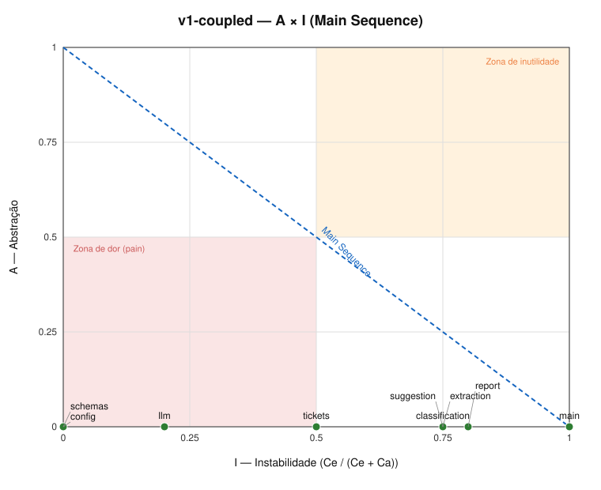
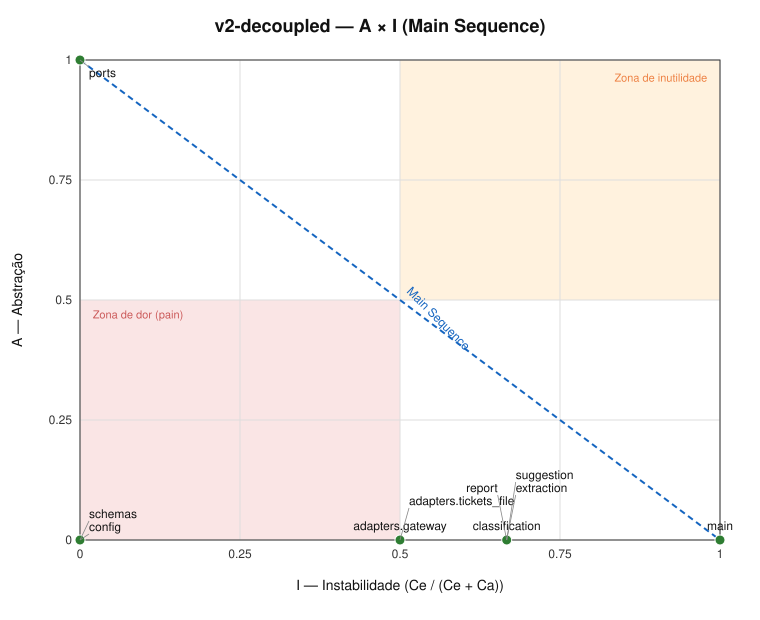
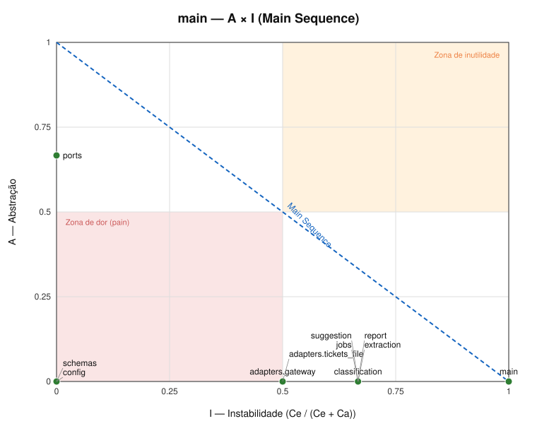

# Helpdesk com IA: da integração frágil à arquitetura resiliente

Este repositório é o fork de solução do desafio https://github.com/devfullcycle/desafio-arquitetura-era-ia-1 (o enunciado completo vive lá). Ele parte da aplicação herdada (`app/`) e a evolui, com decisões registradas e evidência medida, até uma arquitetura resiliente atrás de um AI Gateway. Três marcos ficam no histórico:

| Referência | O que é |
|---|---|
| tag `v1-coupled` | a aplicação herdada, mais a suíte de caracterização que fixa o comportamento dela |
| tag `v2-decoupled` | a refatoração sem mudança de comportamento: toda chamada a modelo pelo gateway, ports e adapters na app |
| `main` | a versão final: resiliência, fallback e governança no gateway, e o modo de execução de cada feature |

Todos os comandos assumem a raiz do repositório, a stack no ar (`docker compose up -d --build --wait`) e o cliente sempre entrando pela borda (`localhost:8000`). Variáveis usadas nos exemplos:

```bash
T1='{"ticket_id":"TK-00042","text":"Meu pedido #481516 não chegou e já passou do prazo, urgente"}'
T2='{"ticket_id":"TK-00002","text":"Tenho aqui a nota fiscal 530720. O produto veio quebrado na caixa, pedido #605065. Sou cliente da loja há bastante tempo. Fico no aguardo de uma solução."}'
```

## Visão geral

O helpdesk tem quatro features de IA: F1 classificação, F2 sugestão de resposta, F3 relatório de tópicos e F4 extração de pedido. Todas consomem modelos só por um AI Gateway self-hosted (LiteLLM Proxy, serviço `gateway`, com Postgres próprio). A app conhece apenas quatro capacidades lógicas (`classify`, `suggest`, `topics`, `extract`) e uma chave virtual com teto de US$ 80 a cada 30 dias. Modelo físico, provider, preço, timeout, retry e fallback de cada capacidade ficam em `gateway/config.yaml`, e trocar um modelo é editar esse arquivo e reiniciar o gateway, sem tocar na app. Cada feature roda no modo que o contrato pede: F1 e F4 síncronas (~1,1 s), F2 em streaming SSE (1º trecho em ~0,8 s, texto completo em ~16 s) e F3 como job assíncrono (`202`, consulta do estado, `303`; o mês inteiro fica pronto em ~89 s). Dentro da app, as features dependem de ports, e o único componente que chama o gateway é `app/helpdesk/adapters/gateway.py`.

Quando um provider cai, o gateway repete uma vez em erro transitório (nenhuma vez em timeout) e passa para o modelo large equivalente no outro provider, que dá a mesma resposta: com a OpenAI fora, a F1 responde `200` em ~3 s. Se nenhum large estiver disponível, vale a política de cada feature: F1, F2 e F3 aceitam o modelo mini (resposta igual ou mais curta), e a F4 responde `503` explícito, porque o mini troca o número do pedido pelo da nota fiscal e a extração alimenta uma automação sem revisão humana. Nada fica pendurado: cada tentativa tem timeout no gateway (4, 5 ou 15 s, conforme a capacidade), e cada feature tem prazo total na app: 13 s nas síncronas e 20 s até o 1º trecho da F2, abaixo dos 30 s da borda, e 50 s por lote da F3, que roda fora da requisição. A falha chega como `503` com `detail` e `Retry-After`, como `event: error` no meio do stream ou como job `failed` com o motivo. Em nenhum cenário medido a borda respondeu `504`.

## Diagnóstico da v1

Todas as medições abaixo foram feitas contra a v1 (commit base `a1aedd7`) pela borda; os trechos de `/admin/calls` citados vêm de `GET localhost:8090/admin/calls`.

### Dor 1: o relatório mensal nunca chega

**Comando**

```bash
curl -s -X POST localhost:8090/admin/reset
curl -s -o /dev/null -w 'status=%{http_code} ttfb=%{time_starttransfer} total=%{time_total}\n' \
  -X POST localhost:8000/reports/topics -H 'Content-Type: application/json' \
  -d '{"start":"2026-08-01","end":"2026-08-31"}'
# em seguida, nos minutos seguintes:
curl -s "localhost:8090/admin/calls?last=100"
```

**Observado**

- O cliente recebe `504` aos 30,02 s (`status=504 ttfb=30.018731 total=30.018798`), vindo do nginx.
- O mês tem 5.000 tickets = 34 lotes de 150, processados em sequência, ~9,7 s cada (média 9.746 ms). O laço terminou ~331,5 s depois do início.
- Em `/admin/calls`, o número de chamadas `task=topics` cresce depois do 504: 4 em t=31 s, 10 em t=90 s, 19 em t=180 s, 31 em t=300 s, 34 em t=400 s (todas `200`).
- Total: 34 chamadas, 222.114 tokens de entrada e 12.162 de saída = US$ 0,8488 (claude-fake-large, US$ 3/M entrada, US$ 15/M saída). Chamadas iniciadas depois do 504: 30, com 195.483 de entrada e 10.742 de saída = US$ 0,7476 (88% do custo) pagos por uma resposta que ninguém recebeu. Desistir não é cancelar.

**Causa no código**

- `app/helpdesk/report.py:15-22`: laço sequencial sobre os lotes, uma chamada bloqueante de cada vez, sem limite de tempo total, sem paralelismo e sem detecção de que o cliente desistiu.
- `app/helpdesk/main.py:30-32`: a rota devolve o relatório inteiro na mesma requisição HTTP (síncrono por contrato); a borda corta em 30 s (`edge/nginx.conf`, `proxy_read_timeout 30s`) mas o app continua trabalhando.
- `app/helpdesk/config.py:18`: `TICKETS_PER_CALL = 150`, fixo.

### Dor 2: o atendente olha uma tela parada

**Comando**

```bash
curl -s -X POST localhost:8090/admin/reset
curl -sN -w '\nstatus=%{http_code} ttfb=%{time_starttransfer} total=%{time_total}\n' \
  -X POST localhost:8000/tickets/reply-suggestion -H 'Content-Type: application/json' -d "$T2"
curl -s "localhost:8090/admin/calls?last=3"
```

**Observado**

- `status=200 ttfb=16.135914 total=16.135979`: nenhum byte antes do fim (ttfb ≈ total). Com TK-00042: 15,96 s.
- `/admin/calls`: `task=suggest`, `stream=false`, `output_tokens=613`, `duration_ms=16127`. A saída longa (~600 tokens a 40 tokens/s no large) só é entregue quando termina.
- Para comparação, as outras features respondem em ~1,1 s (classificação e extração) e o relatório de um dia (137 tickets, 1 lote) em ~9,8 s.

**Causa no código**

- `app/helpdesk/llm.py:20-26`: `anthropic_client.messages.create(...)` sem `stream=True`; o texto só existe quando a chamada inteira termina.
- `app/helpdesk/suggestion.py:6-7` e `app/helpdesk/main.py:20-22`: a rota devolve um `ReplySuggestion` completo (JSON), sem resposta incremental.

### Dor 3: um provider fora do ar derruba parte do helpdesk

**Comando**

```bash
# (i) Anthropic caída
curl -s -X POST localhost:8090/admin/reset
curl -s -X POST localhost:8090/admin/failures -H 'Content-Type: application/json' -d '{"provider":"anthropic","mode":"error_500"}'
for r in "tickets/classification $T1" "tickets/extraction $T2" "tickets/reply-suggestion $T1"; do
  set -- $r; curl -s -o /dev/null -w "$1 status=%{http_code} total=%{time_total}\n" -X POST localhost:8000/$1 -H 'Content-Type: application/json' -d "$2"
done
curl -s -o /dev/null -w 'reports/topics status=%{http_code} total=%{time_total}\n' -X POST localhost:8000/reports/topics -H 'Content-Type: application/json' -d '{"start":"2026-08-01","end":"2026-08-31"}'
curl -s "localhost:8090/admin/calls?last=30"

# (ii) OpenAI caída: mesmo roteiro, com
curl -s -X POST localhost:8090/admin/reset
curl -s -X POST localhost:8090/admin/failures -H 'Content-Type: application/json' -d '{"provider":"openai","mode":"error_500"}'

# (iii) Anthropic pendurada (timeout)
curl -s -X POST localhost:8090/admin/reset
curl -s -X POST localhost:8090/admin/failures -H 'Content-Type: application/json' -d '{"provider":"anthropic","mode":"timeout"}'
curl -s -o /dev/null -w 'status=%{http_code} total=%{time_total}\n' -X POST localhost:8000/tickets/reply-suggestion -H 'Content-Type: application/json' -d "$T1"
curl -s "localhost:8090/admin/calls?last=5"   # repetir aos ~35 s, ~310 s e ~330 s
```

**Observado**

| Cenário | F1 classificação | F4 extração | F2 sugestão | F3 relatório |
|---|---|---|---|---|
| (i) anthropic `error_500` | 200 (1,09 s) | 200 (1,09 s) | **500** (1,36 s) | **500** (1,36 s) |
| (ii) openai `error_500` | **500** (1,25 s) | **500** (1,46 s) | 200 (15,96 s) | 200 (9,83 s, 1 dia) |

- Corpo do erro: `Internal Server Error` (500 sem corpo útil; nenhuma mensagem para o atendente, nenhum fallback).
- Tentativas por requisição que falha: 3 em `/admin/calls` (1 original + 2 retentativas automáticas do SDK, com backoff curto de ~0,4 s e ~1 s). No F3 o laço morre no primeiro lote.
- (iii) `timeout`: F2 termina em `504` aos 30,03 s (borda) mas a chamada continua aberta no provider: aos 35 s, 120 s e 290 s `status=504 duration_ms=null`. Aos ~300 s o provider devolve o 504, o SDK trata como 5xx e abre uma **segunda tentativa** (visível às 00:10:02, 300 s depois da primeira), de novo pendurada. A thread do app fica bloqueada até ~900 s (3 tentativas × 300 s) por requisição.

**Causa no código**

- `app/helpdesk/config.py:10-13`: cada feature está atada a um único modelo/provider (classificação e extração na OpenAI, sugestão e relatório na Anthropic); `app/helpdesk/classification.py:11`, `extraction.py:12`, `suggestion.py:6`, `report.py:18` chamam o provider diretamente, sem alternativa.
- `app/helpdesk/llm.py:8-9`: clientes criados sem `timeout` nem `max_retries`, valendo os padrões do SDK (ver abaixo).
- `app/helpdesk/main.py:15-32`: rotas `def` síncronas, executadas no pool de threads do FastAPI; chamadas penduradas ocupam threads, e sem limite próprio de tempo a capacidade do app encolhe.

### Dor 4: trocar um modelo exige alterar código e reconstruir a imagem

**Comando**

```bash
curl -s -X POST localhost:8090/admin/reset
sed -i 's/^CLASSIFICATION_MODEL = .*/CLASSIFICATION_MODEL = "gpt-fake-mini"/' app/helpdesk/config.py
docker compose restart app
curl -s -X POST localhost:8000/tickets/classification -H 'Content-Type: application/json' -d "$T1"
curl -s "localhost:8090/admin/calls?last=1"      # ainda gpt-fake-large
docker compose up -d --build app
curl -s -X POST localhost:8000/tickets/classification -H 'Content-Type: application/json' -d "$T1"
curl -s "localhost:8090/admin/calls?last=1"      # agora gpt-fake-mini
git checkout -- app/helpdesk/config.py && docker compose up -d --build app   # reverter
```

**Observado**

- Antes: `gpt-fake-large`, 1,09 s. Após editar o arquivo e só `restart`: continua `gpt-fake-large` (1,10 s). Após `up -d --build`: `gpt-fake-mini`, 0,41 s.
- A mudança de um modelo exigiu editar fonte e reconstruir a imagem.

**Causa no código**

- `app/helpdesk/config.py:10-13`: nomes de modelo como constantes no código; `config.py:3-7`: chaves e URLs dos providers lidas no app (`FAKE_*_KEY` via `env_file: .env`, `compose.yaml:20`) e URLs fixas no fonte.
- `app/Dockerfile:6`: `COPY helpdesk ./helpdesk` assa o código na imagem; `compose.yaml:19` usa `build: ./app` sem volume para o código, então `restart` reaproveita a imagem antiga.
- Cada serviço do app conhece diretamente os dois SDKs (`app/helpdesk/llm.py:3-4`), sem camada de roteamento.

### Padrões dos SDKs

Medidos dentro do container `app` (`docker compose exec app python -c ...`, imprimindo `openai._constants` / `anthropic._constants` e os clientes de `helpdesk.llm`):

| SDK | Versão | Timeout padrão | `max_retries` |
|---|---|---|---|
| openai | 3.19.0 | connect 5 s, read/write/pool **600 s** | **2** |
| anthropic | 1.8.0 | connect 5 s, read/write/pool **600 s** | **2** |

Os clientes de `llm.py:8-9` herdam esses valores. A borda desiste em 30 s: o SDK espera até 20× mais, e ainda tenta de novo em 5xx/429/timeout. Resultado: o cliente vê 504 enquanto o app segue ocupado e gastando.

### Modelos mini × large

Chamadas direto ao provider (`localhost:8090`). Varredura dos 5.000 tickets de `data/tickets.jsonl` em `classify` e `extract` (large × mini, `gpt-fake-*`, concorrência 100, 0 erros), mais `topics` (3 lotes de 150) e `suggest` (5 tickets) nos dois providers.

| Tarefa | Resultado mini vs large | Latência / custo |
|---|---|---|
| classify | **5.000/5.000 idênticos** (0 diferenças em categoria e prioridade) | ~0,4 s vs ~1,1 s; US$ 0,15/0,60 vs 2,50/10,00 por 1M |
| extract | 3.467 idênticos, **1.533 diferentes (30,7%)**: 717 `order_number` divergentes, 953 `product` divergentes | idem |
| topics (3 lotes) | idêntico nos 3 lotes (15 temas, soma 150); mini = large | ~2,7 s vs ~9,8 s por lote |
| suggest (5 tickets) | texto diferente nos 5 tickets, mini mais curto (~1.070 caracteres / ~267 tokens vs ~2.430 / ~605); mesmo padrão nos 5 | ~2,1 s vs ~16 s |

- Falha do mini em `extract`: devolve o número da **nota fiscal** em vez do pedido (717 casos) e `product: null` onde o large acha o produto (953 casos). Exemplos: TK-00002 large `{"order_number":"#605065","product":null}`, mini `{"order_number":"#530720",...}` (a nota fiscal); TK-00015 large `#972600`, mini `#197527` (nota fiscal); TK-00007 large `product: "notebook 14 polegadas"`, mini `product: null`; TK-00030 large `cortina blackout`, mini `null`.
- `gpt-fake-large` e `claude-fake-large` produziram saída idêntica em todos os 400 testes (200 tickets × classify/extract), e também em topics (3 lotes) e suggest (5 tickets). O mesmo vale para os dois minis entre si em topics e suggest. Logo, large ↔ large é um fallback transparente entre providers; mini ↔ large não é equivalente em `extract` (e muda o texto em `suggest`), mas é equivalente em `classify` e, nos lotes testados, em `topics`.

## Como rodar

### Requisitos do host

- Docker com Compose v2 (testado com 2.39.2);
- `python3` ≥ 3.11, para as suítes de teste e o script de métrica;
- `bash` e `curl`;
- portas 8000, 8090 e 4000 livres.

### Subir a stack

```bash
cp .env.example .env && docker compose up -d --build --wait
curl -s localhost:8000/health   # {"status":"ok"}
```

A subida a frio leva ~27 s. O `--wait` volta quando todos os serviços estão `healthy`, e o gateway só fica `healthy` com as chaves virtuais provisionadas e todos os deployments carregados.

| Serviço | Porta no host | Papel |
|---|---|---|
| `edge` | 8000 | a borda (nginx, do desafio): entrada oficial; encerra com `504` o upstream que passa 30 s sem enviar bytes |
| `app` | — (8080 na rede interna) | o helpdesk (FastAPI); fala só com o gateway |
| `gateway` | 4000 | AI Gateway (LiteLLM Proxy), API compatível com OpenAI; administração com a master key ([ADR 0002](docs/adr/0002-ai-gateway-self-hosted.md)) |
| `gateway-db` | — (5432 na rede interna) | Postgres do gateway: chaves virtuais e gasto, no volume `gateway-db-data` ([ADR 0008](docs/adr/0008-banco-do-gateway.md)) |
| `provider-fake` | 8090 | os dois providers simulados (do desafio); falhas em `POST /admin/failures`, chamadas em `GET /admin/calls`, `POST /admin/reset` |

`docker compose down` preserva chaves e gasto; `docker compose down -v` zera os dois, e o próximo `up` recria as chaves.

### Testes de caracterização

```bash
./tests/run.sh characterization   # 20 passed, ~53 s
```

Fixam o comportamento externo pela borda, com corpos completos e não só status: classificação, sugestão de resposta, relatório de tópicos (um dia, 137 tickets), extração e erros de validação (`422`). Os textos longos ficam em `tests/characterization/golden/`.

- **Nas tags, o contrato síncrono da v1.** A suíte é idêntica em `v1-coupled` e `v2-decoupled` (`git diff v1-coupled v2-decoupled -- tests/characterization/` é vazio): foi ela que provou que a refatoração da v2 não mudou comportamento.
- **Na `main`, só dois testes mudaram**, junto com o contrato ([ADR 0004](docs/adr/0004-modo-de-execucao-por-feature.md)): a F2 é lida como SSE, e a concatenação dos trechos é comparada com o mesmo golden; a F3 passa por `202` → estado → `303` → resultado, comparado com o mesmo golden. Os goldens não mudaram.
- Variáveis: `BASE_URL` (padrão `http://localhost:8000`) e `PROVIDER_URL` (padrão `http://localhost:8090`). O script cria `.venv/` e instala `tests/requirements.txt` sozinho, e argumentos extras vão para o pytest (`./tests/run.sh characterization -k health`).

**Rodar contra uma tag**, com a suíte da própria tag. As portas são as mesmas, então a stack da `main` sai do ar antes:

```bash
docker compose down                             # na main; chaves e gasto ficam no volume
git worktree add ../helpdesk-v1 v1-coupled      # ou v2-decoupled
cd ../helpdesk-v1
cp .env.example .env && docker compose up -d --build --wait
./tests/run.sh characterization                 # 20 passed
docker compose down -v
cd - && git worktree remove ../helpdesk-v1
docker compose up -d --wait                     # a main de volta
```

Medido em 2026-10-11: `v1-coupled` 20 passed em 51,94 s; `v2-decoupled` 20 passed em 52,28 s; `main` 20 passed em 53,07 s. Os comandos da seção [Diagnóstico da v1](#diagnóstico-da-v1) valem com a stack da tag `v1-coupled` no ar.

### Testes de aceitação

```bash
./tests/run.sh acceptance   # 16 passed, ~3–4 min (o relatório do mês leva ~90 s)
```

Conferem os critérios do desafio pela borda, provocando falhas no provider-fake e contando as tentativas em `/admin/calls`:

- F1 em até 3 s, e em até 15 s com o primário pendurado;
- 1º trecho da F2 rápido, texto chegando até o `event: end`, e `event: error` no meio do stream;
- relatório do mês assíncrono (`202` → estado → `303` → resultado);
- fallback técnico nas quatro features e modelo fraco só onde é aceito;
- `503` explícito na F4 sem os large;
- job `failed` com motivo em menos de 60 s.

Um hook do cliente HTTP reprova qualquer resposta `504`. Cada teste zera o provider antes e depois (não rode com a stack em uso por outra pessoa). Mesmas variáveis e requisitos da caracterização.

### Métrica de acoplamento

```bash
python3 metrics/coupling.py app/helpdesk --name main
```

Calcula Ca, Ce, I, A e D por módulo de `app/helpdesk/`, imprime a tabela e a zona de dor (A < 0,5, I < 0,5, D ≥ 0,5) e grava `metrics/results/<nome>.csv` e `.svg` (`--out-dir` muda a pasta). Só usa a biblioteca padrão e não importa nem executa a app. Testes do próprio script, com o `.venv/` criado por uma das suítes: `.venv/bin/python -m pytest -q metrics/tests`.

Para medir uma tag com a régua atual, sem mexer na cópia de trabalho (reproduz o CSV versionado byte a byte):

```bash
git worktree add /tmp/medir-v1 v1-coupled
python3 metrics/coupling.py /tmp/medir-v1/app/helpdesk --name v1-coupled
git worktree remove /tmp/medir-v1
```

### Roteiro de governança

```bash
./scripts/governance-demo.sh   # ~6 s; saída esperada em "Roteiro de governança", abaixo
```

## Métrica

`metrics/results/v1-coupled.svg`, `v2-decoupled.svg` e `main.svg`:







| Componente | D v1 | D v2 | D `main` | Zona de dor v1 → v2 → `main` | Ca / Ce / I / A na `main` |
|---|---|---|---|---|---|
| `llm` | **0,80** | removido | — | **sim** → — → — | — |
| `config` | **1,00** | **1,00** | **1,00** | **sim** → sim → sim (exceção declarada) | 1 / 0 / 0,00 / 0,00 |
| `schemas` | **1,00** | **1,00** | **1,00** | **sim** → sim → sim (exceção declarada) | 6 / 0 / 0,00 / 0,00 |
| `ports` | — | 0,00 | 0,33 | — → não → não | 7 / 0 / 0,00 / 0,67 |
| `adapters.gateway` | — | 0,50 | 0,50 | — → não → não | 1 / 1 / 0,50 / 0,00 |
| `adapters.tickets_file` (na v1, `tickets`) | 0,50 | 0,50 | 0,50 | não → não → não | 1 / 1 / 0,50 / 0,00 |
| `classification`, `extraction`, `suggestion` | 0,25 | 0,33 | 0,33 | não → não → não | 1 / 2 / 0,67 / 0,00 |
| `report` | 0,20 | 0,33 | 0,33 | não → não → não | 1 / 2 / 0,67 / 0,00 |
| `jobs` | — | — | 0,33 | — → — → não | 1 / 2 / 0,67 / 0,00 |
| `main` | 0,00 | 0,00 | 0,00 | não → não → não | 0 / 9 / 1,00 / 0,00 |

Zona de dor impressa pelo script: v1 `config, llm, schemas`; v2 `config, schemas`; `main` `config, schemas`.

Leitura:

- **`llm` saiu.** Era o nó do acoplamento com os providers (Ca 4, D 0,80): importava os dois SDKs, criava os clientes com as chaves dos providers e deixava a feature escolher o provider pelo nome da função. Provider, chave e modelo físico foram para o gateway. Na app, a chamada ficou num componente só.
- **`config` perdeu dependentes, não o D.** O Ca caiu de 6 para 1 (só `main` o lê), e as chaves e os nomes físicos de modelo saíram dele. O D continua 1,00 porque toda folha concreta com um importador tem D = 1: a rigidez que a zona aponta (muitos arrastados por uma mudança) deixou de existir, mas o número não mostra isso.
- **`ports` é a abstração para onde as dependências apontam.** Na v2, A = 1 e D = 0, na Main Sequence. Na `main`, ganhou a exceção `LanguageModelUnavailable` (1 exceção para 2 `Protocol`s): A = 0,67 e D = 0,33, ainda fora da zona. Ca 6 → 7, com `jobs`.
- **As features ficaram em I = 0,67** (Ce = {`ports`, `schemas`}, Ca = `main`). O D delas subiu de 0,20–0,25 para 0,33 porque trocaram duas dependências concretas e voláteis (`config`, `llm`) por uma abstrata. A métrica premiaria a dependência errada, e por isso a direção é conferida por regra, não pelo D.
- **Os adapters ficam em I = 0,50 por desenho.** Cada um é importado só por `main` (Ca = 1) e herda nominalmente o port que implementa (Ce = 1). Estão na fronteira, sem folga: um segundo importador os poria na zona.
- **`jobs`** (o registro dos jobs da F3, só na `main`) segue o padrão das features: Ca = 1, Ce = {`ports`, `schemas`}, D = 0,33.
- **Exceções declaradas:** `schemas` (tipos de valor do contrato HTTP, sem comportamento) e `config` (folha de constantes com um único leitor). A justificativa e as regras que a métrica não mede (R-a a R-f: imports das features, só `main` importa `config`/`adapters`/`jobs`, Ca = 1 nos adapters, exceções do port, direção das arestas) estão no [ADR 0010](docs/adr/0010-leitura-da-metrica-de-acoplamento.md), com os comandos.

**O componente que chama o gateway é `app/helpdesk/adapters/gateway.py`.** É o único módulo da app que importa o SDK `openai`. Quem o importa é só `main.py`, o ponto de composição; nenhuma feature depende dele:

```bash
grep -rln openai app/helpdesk                         # app/helpdesk/adapters/gateway.py
grep -rlE "^\s*(from|import) .*adapters" app/helpdesk # app/helpdesk/main.py
```

## Tabela de capacidades

| Capacidade lógica | Feature | Modelo primário | Fallback técnico | Política com modelo fraco | Timeout por tentativa | Tentativas máximas por destino (primário / fallback técnico / fraco) |
|---|---|---|---|---|---|---|
| `classify` | F1 classificação | `openai/gpt-fake-large` | `anthropic/claude-fake-large` | **aceito**: `openai/gpt-fake-mini` (classificou igual ao large nos 5.000 tickets) | 4 s | `500`/`429`: 2 / 2 / 1; timeout: 1 / 1 / 1 |
| `suggest` | F2 sugestão | `anthropic/claude-fake-large` | `openai/gpt-fake-large` | **aceito**: `anthropic/claude-fake-mini` (texto mais curto, que o atendente revisa) | 5 s por espera no streaming; 20 s sem streaming | `500`/`429`: 2 / 2 / 1; timeout ou lento antes do 1º trecho: 1 / 1 / 1; erro no meio do stream, depois de conteúdo: 1 / 0 / 0 |
| `topics` | F3 relatório | `anthropic/claude-fake-large` | `openai/gpt-fake-large` | **aceito**: `anthropic/claude-fake-mini` (mesmos tópicos nos lotes comparados) | 15 s | por lote: `500`/`429`: 2 / 2 / 1; timeout: 1 / 1 / 1 |
| `extract` | F4 extração | `openai/gpt-fake-large` | `anthropic/claude-fake-large` | **recusado**: não existe `extract-weak` (o mini errou o pedido em 717 de 5.000 tickets) | 4 s | `500`/`429`: 2 / 2 / —; timeout: 1 / 1 / — |

Tentativas contadas em `GET localhost:8090/admin/calls`, uma requisição por cenário, com o provider zerado antes ([ADR 0006](docs/adr/0006-resiliencia-timeout-retry-e-backoff.md)). No máximo 5 chamadas ao provider por requisição (2 + 2 + 1); 4 na `extract`.

Onde cada coisa é configurada:

- **`gateway/config.yaml`, `model_list`**: um deployment por grupo (`<cap>`, `<cap>-fallback`, `<cap>-weak`), cada um com `model`, preço por token e `timeout`/`stream_timeout`. São 11 deployments escritos por extenso ([ADR 0003](docs/adr/0003-capacidades-logicas-e-mapeamento.md)).
- **`gateway/config.yaml`, `router_settings`**:
  - `retry_policy`: 1 retentativa em `500`, `503` e `429`; nenhuma em timeout, erros do pedido e demais tipos;
  - `model_group_retry_policy`: o fraco tem 1 tentativa só;
  - `fallbacks`: a ordem da cadeia, com `suggest-fallback: [suggest-weak]` por causa do streaming;
  - `disable_cooldowns: true`.

  O porquê de cada valor está nos [ADR 0005](docs/adr/0005-politica-de-fallback.md) e [ADR 0006](docs/adr/0006-resiliencia-timeout-retry-e-backoff.md).
- **`gateway/provision_keys.py`**: a chave da app só enxerga as quatro capacidades; os grupos internos ficam fora da lista dela ([ADR 0007](docs/adr/0007-governanca-chaves-orcamentos-e-limites.md)).
- **Na app**: só o nome lógico (`CAPABILITY` em cada feature), `max_retries=0` no cliente e o prazo total de cada feature.

## Tabela de fallback

Quando **nenhum large** está disponível (os dois large em `error_500`):

| Feature | O que acontece | Status | Observado pela borda |
|---|---|---|---|
| F1 classificação | a classificação sai pelo `gpt-fake-mini`, igual à do large | `200` | `200` em 4,75–5,10 s; `/admin/calls`: `gpt-fake-large` 500 ×2, `claude-fake-large` 500 ×2, `gpt-fake-mini` 200 |
| F2 sugestão | a sugestão sai pelo `claude-fake-mini`, mais curta (~1.070 caracteres, contra ~2.430) | `200`, SSE até o `event: end` | 1º trecho aos 4,90 s; 267 trechos; fim aos 6,83 s |
| F3 relatório | o job termina (`done`) pelo `claude-fake-mini`, com os mesmos tópicos | `202` → `303` → `200` | relatório de um dia pronto aos 7,08 s |
| F4 extração | erro explícito, sem chamar o mini | `503` com `Retry-After: 10` | `503` em 4,74 s; `gpt-fake-large` 500 ×2, `claude-fake-large` 500 ×2, nenhum mini |

Corpo do `503` da F4:

```json
{"detail": "Extração indisponível no momento: os modelos confiáveis para extração falharam e, por política, nenhum modelo menos confiável é usado. Encaminhe o ticket para tratamento manual."}
```

**Fallback técnico** (o provider inteiro do primário fora): as quatro features respondem pelo large do outro provider, com a mesma resposta, depois de 2 tentativas no primário. Tempos pela borda: F1 `200` em 3,04 s; F4 `200` em 3,70 s; F2 com o 1º trecho aos 3,30 s; F3 de um dia pronta aos 12,11 s.

Com os **dois providers inteiros** fora, o mini também falha: F1 e F2 respondem `503` em 4,2–4,5 s, a F3 marca o job `failed` com o motivo em ~4 s, e a F4 responde `503`. Com os dois providers pendurados, os mesmos erros saem em 12 s (F1), 15 s (F2) e 45 s (F3). A decisão por feature está no [ADR 0005](docs/adr/0005-politica-de-fallback.md).

## Fluxos

O modo de cada feature e o porquê estão no [ADR 0004](docs/adr/0004-modo-de-execucao-por-feature.md).

### F1 classificação: síncrona

Envie o ticket e receba a classificação inteira na mesma resposta.

```bash
curl -s -X POST localhost:8000/tickets/classification -H 'Content-Type: application/json' -d "$T1"
# {"ticket_id":"TK-00042","category":"delivery","priority":"high"}   (~1,1 s)
```

| Situação | Status | Corpo |
|---|---|---|
| sucesso | `200` | `{"ticket_id", "category", "priority"}` |
| nenhum modelo respondeu, ou o prazo de 13 s estourou | `503` + `Retry-After: 10` | `{"detail": "Classificação indisponível no momento: nenhum modelo de linguagem conseguiu responder. Tente de novo em instantes."}` |
| valor fora do permitido | `502` | `{"detail": "Classificação fora dos valores permitidos"}` |
| entrada inválida | `422` | erro de validação (pydantic) |

### F2 sugestão de resposta: streaming (SSE)

Leia o corpo à medida que chega (`curl -N`, `EventSource` ou leitura de stream do cliente HTTP). Cada evento `data:` traz um trecho do texto; o stream termina com `event: end` ou, se a geração quebrar no meio, com `event: error`.

```bash
curl -N -X POST localhost:8000/tickets/reply-suggestion -H 'Content-Type: application/json' -d "$T2"
```

```text
data: {"chunk": "Olá!"}

data: {"chunk": " Lam"}

...

data: {"chunk": "to."}

event: end
data: {"ticket_id": "TK-00002"}
```

O 1º trecho chega em ~0,8 s, e os seguintes a cada ~25 ms, até ~16,5 s. A concatenação dos `chunk` é o texto completo da sugestão.

| Situação | Resposta |
|---|---|
| sucesso | `200`, `Content-Type: text/event-stream; charset=utf-8`, `Cache-Control: no-cache`; eventos `data: {"chunk": "<texto>"}` e, no fim, `event: end` + `data: {"ticket_id": "<id>"}` |
| a geração quebra depois do 1º trecho, ou passa 10 s sem trecho novo | `event: error` + `data: {"ticket_id": "<id>", "message": "A geração foi interrompida"}`, e o stream fecha |
| nenhum modelo começou a responder, ou o 1º trecho não veio em 20 s | `503` JSON comum, com `Retry-After: 10` e `{"detail": "Sugestão de resposta indisponível no momento: nenhum modelo de linguagem conseguiu responder. Tente de novo em instantes."}` |
| entrada inválida | `422` |

### F3 relatório de tópicos: assíncrono (Asynchronous Request-Reply)

Peça o relatório, guarde o `Location`, consulte o estado respeitando o `Retry-After` até receber `303`, e busque o resultado no `Location` do `303` (ou deixe o cliente seguir o redirect, `curl -L`). Se o estado vier `failed`, o motivo está em `reason`.

```bash
curl -s -i -X POST localhost:8000/reports/topics -H 'Content-Type: application/json' \
  -d '{"start":"2026-08-01","end":"2026-08-31"}'
```

```text
HTTP/1.1 202 Accepted
location: /reports/topics/status/640d7fcd82bc401ca4c2aa47f5e62086
retry-after: 5

{"job_id":"640d7fcd82bc401ca4c2aa47f5e62086","state":"pending","progress":"0/5000"}
```

Pedir, consultar até o fim e buscar o resultado:

```bash
LOC=$(curl -s -o /dev/null -D - -X POST localhost:8000/reports/topics \
  -H 'Content-Type: application/json' -d '{"start":"2026-08-01","end":"2026-08-31"}' \
  | tr -d '\r' | sed -n 's/^[Ll]ocation: //p')
while :; do
  body=$(curl -s -w '\n%{http_code}' "localhost:8000$LOC")
  code=${body##*$'\n'}; echo "$code ${body%$'\n'*}"
  [ "$code" != 200 ] || [[ $body == *'"failed"'* ]] && break
  sleep 5                                     # o Retry-After
done
curl -s -L "localhost:8000$LOC"               # segue o 303 até o relatório
```

```text
200 {"job_id":"640d7fcd...","state":"running","progress":"0/5000"}
200 {"job_id":"640d7fcd...","state":"running","progress":"600/5000"}
...
200 {"job_id":"640d7fcd...","state":"running","progress":"4800/5000"}
303
{"start":"2026-08-01","end":"2026-08-31","total_tickets":5000,"topics":[{"topic":"Atraso na entrega","count":570,"examples":["TK-00010","TK-00025","TK-00028"]},...
```

O `POST` responde em ~0,04 s, e o mês (34 lotes de 150, 4 em paralelo) fica pronto em ~89 s. Um dia (137 tickets) leva ~10 s.

| Rota | Situação | Status e headers | Corpo |
|---|---|---|---|
| `POST /reports/topics` | pedido aceito | `202`, `Location: /reports/topics/status/<id>`, `Retry-After: 5` | `{"job_id", "state": "pending", "progress": "0/<tickets do período>"}` |
| | `start > end` ou data inválida | `422` | `{"detail": "A data inicial é posterior à data final"}` ou erro de validação |
| `GET /reports/topics/status/<id>` | em andamento | `200`, `Retry-After: 5` | `{"job_id", "state": "pending" \| "running", "progress": "<n>/<total>"}` |
| | falhou | `200` | `{"job_id", "state": "failed", "progress", "reason": "<motivo>"}` |
| | pronto | `303`, `Location: /reports/topics/<id>` | vazio |
| | id desconhecido ou já descartado | `404` | `{"detail": "Relatório não encontrado (id desconhecido ou já descartado)"}` |
| `GET /reports/topics/<id>` | pronto | `200` | `{"start", "end", "total_tickets", "topics"}`, o mesmo corpo da v1 |
| | ainda gerando | `409`, `Location` (o estado), `Retry-After: 5` | `{"detail": "O relatório ainda está sendo gerado (<n>/<total> tickets); consulte /reports/topics/status/<id>"}` |
| | falhou | `409` | `{"detail": "O relatório falhou: <motivo>"}` |
| | id desconhecido | `404` | como acima |

### F4 extração de pedido: síncrona

Envie o ticket e receba o número do pedido e o produto na mesma resposta.

```bash
curl -s -X POST localhost:8000/tickets/extraction -H 'Content-Type: application/json' -d "$T2"
# {"ticket_id":"TK-00002","order_number":"#605065","product":null}   (~1,1 s)
```

| Situação | Status | Corpo |
|---|---|---|
| sucesso | `200` | `{"ticket_id", "order_number", "product"}` (`null` no que não for encontrado) |
| os dois modelos confiáveis falharam, ou o prazo de 13 s estourou | `503` + `Retry-After: 10` | `{"detail": "Extração indisponível no momento: os modelos confiáveis para extração falharam e, por política, nenhum modelo menos confiável é usado. Encaminhe o ticket para tratamento manual."}` |
| pedido em formato inválido | `502` | `{"detail": "Número de pedido em formato inválido"}` |
| entrada inválida | `422` | erro de validação |

### Campos e respostas além dos contratos sugeridos

- **F1, F2 e F4:** `503` com `detail` legível e `Retry-After: 10` quando nenhum modelo responde. Na F2, isso só acontece antes do 1º trecho; depois dele, a falha é o `event: error` do contrato.
- **F2:** o `event: end` traz `data: {"ticket_id": "<id>"}`. O `200` só é enviado depois do 1º trecho.
- **F3, no corpo do `202` e do estado, além do `state`:**
  - `job_id`, o mesmo id do `Location`;
  - `progress`, como `"<tickets dos lotes concluídos>/<tickets do período>"`;
  - `reason`, só quando `failed`.
- **F3, no estado:** `Retry-After` enquanto o job não termina.
- **F3, na URL do resultado:** `409` antes de pronto (com `Location` e `Retry-After`) ou depois de `failed` (com o motivo), e `404` para id desconhecido.
- **F3, outros detalhes:**
  - os `Location` são relativos, porque a borda repassa o `Host` sem a porta;
  - período sem tickets dá um job pronto na hora;
  - a app guarda os 100 jobs mais recentes, na memória: um restart da app perde os jobs.

## Troca de modelo

Trocar o modelo de uma capacidade é uma edição em `gateway/config.yaml` e um restart do gateway. A app não é reconstruída nem reiniciada ([ADR 0003](docs/adr/0003-capacidades-logicas-e-mapeamento.md)). Exemplo, já executado: `classify` do `gpt-fake-large` para o `gpt-fake-mini`.

1. Anote o start da app:

   ```bash
   docker inspect -f '{{.State.StartedAt}}' $(docker compose ps -q app)
   ```

2. Em `gateway/config.yaml`, no deployment da capacidade (`- model_name: classify`), troque a linha `model:` e as duas de preço (em decimal; os preços de cada modelo estão no comentário do topo do arquivo):

   ```diff
      - model_name: classify
        litellm_params:
   -      model: openai/gpt-fake-large
   +      model: openai/gpt-fake-mini
          api_base: http://provider-fake:8090/openai/v1
          api_key: os.environ/FAKE_OPENAI_KEY
   -      input_cost_per_token: 0.0000025
   -      output_cost_per_token: 0.00001
   +      input_cost_per_token: 0.00000015
   +      output_cost_per_token: 0.0000006
          timeout: 4
   ```

   A mesma edição, por comando:

   ```bash
   sed -i '/- model_name: classify$/,/timeout:/{s|model: openai/gpt-fake-large|model: openai/gpt-fake-mini|;s|input_cost_per_token: 0.0000025$|input_cost_per_token: 0.00000015|;s|output_cost_per_token: 0.00001$|output_cost_per_token: 0.0000006|}' gateway/config.yaml
   ```

3. Reinicie o gateway e espere ele ficar `healthy` (~11–12 s):

   ```bash
   docker compose restart gateway && docker compose up -d --wait gateway
   ```

   Se a linha `model:` tiver erro de digitação, o LiteLLM descarta o deployment em silêncio. O provisionador detecta isso e deixa o gateway `unhealthy`, com a causa no log.

4. Confira:

   ```bash
   set -a; . ./.env; set +a
   curl -s localhost:4000/v1/models -H "Authorization: Bearer $GATEWAY_APP_KEY"   # a app continua vendo classify, suggest, topics, extract
   curl -s localhost:4000/model/info -H "Authorization: Bearer $LITELLM_MASTER_KEY" | python3 -c 'import json, sys
   for m in json.load(sys.stdin)["data"]:
       if m["model_name"] == "classify": print(m["model_name"], "->", m["litellm_params"]["model"])'   # classify -> openai/gpt-fake-mini
   curl -s -X POST localhost:8000/tickets/classification -H 'Content-Type: application/json' -d "$T1"
   curl -s "localhost:8090/admin/calls?last=5"                                     # "model":"gpt-fake-mini"
   docker inspect -f '{{.State.StartedAt}}' $(docker compose ps -q app)             # igual ao anotado
   ```

   O `/v1/models` da chave da app só repete a lista de capacidades dela. O modelo físico aparece no `/model/info` (master key) e em `/admin/calls`.

5. Para voltar: `git checkout -- gateway/config.yaml` e de novo `docker compose restart gateway && docker compose up -d --wait gateway`.

Observado em 2026-10-11:

- antes: `gpt-fake-large`, F1 em 1,11 s;
- depois do restart (gateway `healthy` em 11 s): `/model/info` com `classify -> openai/gpt-fake-mini`, F1 `200` em 0,52 s com a mesma classificação, e `/admin/calls` com `"model":"gpt-fake-mini"` (374 ms);
- app: `StartedAt 2026-10-11T21:20:45.288217668Z` e a mesma imagem, antes e depois;
- revertido: `git diff gateway/config.yaml` vazio e `classify -> openai/gpt-fake-large`.

Ao trocar, revise também o timeout da capacidade (um modelo mais lento estouraria os 4 ou 15 s, [ADR 0006](docs/adr/0006-resiliencia-timeout-retry-e-backoff.md)). Todo modelo de `topics` precisa de contexto ≥ 8.000 tokens.

## Roteiro de governança

O gateway recusa por orçamento e por limite de requisições, antes de chamar o provider. A demonstração usa duas chaves próprias, para não gastar nem mexer no teto da chave da app ([ADR 0007](docs/adr/0007-governanca-chaves-orcamentos-e-limites.md)):

| Chave (alias) | Capacidades | Orçamento | Limite | Uso |
|---|---|---|---|---|
| `helpdesk-app` | `classify`, `suggest`, `topics`, `extract` | US$ 80,00 a cada 30 dias ([ADR 0001](docs/adr/0001-politica-de-providers-e-teto-de-gasto.md)) | — | a app |
| `demo-budget` | `classify` | US$ 0,000005 (menos que uma chamada) | — | a 2ª chamada estoura o orçamento |
| `demo-rpm` | `classify` | — | 2 requisições por minuto | a 3ª chamada no minuto é recusada |

```bash
./scripts/governance-demo.sh
```

Saída observada (6,4 s):

```text
== 1. Orçamento: chave demo-budget
   gasto zerado (antes: US$ 0.0001575; teto: US$ 0.000005)
   chamada 1
    -> 200 {"category": "delivery", "priority": "high"}  custo US$ 0.0001575
   chamada 2
    -> 429 budget_exceeded: Budget has been exceeded! Key=demo-budget (sk-...0001) Current cost: 0.00015750000000000152, Max budget: 5e-06
   chamadas novas no provider: 1

== 2. Limite de taxa: chave demo-rpm (2 por minuto)
   chamada 1
    -> 200 {"category": "delivery", "priority": "high"}  custo US$ 0.0001575
   chamada 2
    -> 200 {"category": "delivery", "priority": "high"}  custo US$ 0.0001575
   chamada 3
    -> 429 throttling_error: Rate limit exceeded for api_key: ca2cb264…8b13. Limit type: requests. Current limit: 2, Remaining: 0. Limit resets at: 2026-10-11 21:50:00 UTC
   chamadas novas no provider: 2

== Resumo
   PASS  orçamento: 1ª chamada aceita (esperado 200, obtido 200)
   PASS  orçamento: 2ª chamada recusada pelo gateway (esperado 429 budget_exceeded, obtido 429 budget_exceeded)
   PASS  orçamento: chamadas que chegaram ao provider (esperado 1, obtido 1)
   PASS  rpm: 1ª chamada aceita (esperado 200, obtido 200)
   PASS  rpm: 2ª chamada aceita (esperado 200, obtido 200)
   PASS  rpm: 3ª chamada recusada pelo gateway (esperado 429 throttling_error, obtido 429 throttling_error)
   PASS  rpm: chamadas que chegaram ao provider (esperado 2, obtido 2)
PASS: orçamento e limite de taxa recusados no gateway, sem chamada ao provider
```

O equivalente em curl, contando as chamadas que chegam ao provider (este roteiro zera o registro do provider; o script não zera):

```bash
set -a; . ./.env; set +a
BODY='{"model":"classify","max_tokens":2000,"messages":[{"role":"user","content":"TASK: classify\nMeu pedido #481516 não chegou e já passou do prazo, urgente"}]}'
chat() { curl -s -o /dev/null -w '%{http_code} ' localhost:4000/v1/chat/completions \
  -H "Authorization: Bearer $1" -H 'Content-Type: application/json' -d "$BODY"; }
calls() { curl -s "localhost:8090/admin/calls?last=100" | python3 -c 'import json, sys; print(len(json.load(sys.stdin)))'; }
curl -s -X POST localhost:8090/admin/reset                      # provider normal, registro vazio
# orçamento: zera o gasto da demo-budget (master key) e faz 2 chamadas
H=$(printf %s "$GATEWAY_DEMO_BUDGET_KEY" | sha256sum | cut -d' ' -f1)
curl -s -X POST "localhost:4000/key/$H/reset_spend" -H "Authorization: Bearer $LITELLM_MASTER_KEY" \
  -H 'Content-Type: application/json' -d '{"reset_to": 0}'
calls                                                           # 0
chat "$GATEWAY_DEMO_BUDGET_KEY"; chat "$GATEWAY_DEMO_BUDGET_KEY"   # 200 429
calls                                                           # 1  (+1)
# limite de taxa: 3 chamadas no mesmo minuto
chat "$GATEWAY_DEMO_RPM_KEY"; chat "$GATEWAY_DEMO_RPM_KEY"; chat "$GATEWAY_DEMO_RPM_KEY"   # 200 200 429
calls                                                           # 3  (+2)
```

- A recusa por orçamento sai como `429` com `"type": "budget_exceeded"`. Para ver o corpo, rode a chamada sem `-o /dev/null`.
- A recusa por limite sai como `429` com `"type": "throttling_error"` e o horário em que a janela vira (`Limit resets at`).
- **A janela do rpm é fixa: 60 s a partir da 1ª requisição.** Repetir logo depois encontra a janela aberta, e a 1ª chamada já sai `429`. O script detecta isso e espera a janela fechar (até ~60 s; a 2ª execução seguida levou 64 s). Os curls acima precisam de 60 s de intervalo entre execuções.

## Mapa de decisões

| ADR | Nível | Resumo |
|---|---|---|
| [0001](docs/adr/0001-politica-de-providers-e-teto-de-gasto.md) | corporativa | Toda feature de IA consome modelos só pelo gateway corporativo, com modelo equivalente em dois providers e teto de US$ 80 a cada 30 dias para o helpdesk |
| [0002](docs/adr/0002-ai-gateway-self-hosted.md) | solução | LiteLLM Proxy self-hosted como serviço `gateway`, entre a app e os providers, com as credenciais só nele |
| [0003](docs/adr/0003-capacidades-logicas-e-mapeamento.md) | solução | A app conhece quatro capacidades lógicas, uma por feature; o modelo físico é mapeado (e trocado) no gateway |
| [0004](docs/adr/0004-modo-de-execucao-por-feature.md) | solução | Modo de execução por feature: F1 e F4 síncronas, F2 em streaming SSE, F3 assíncrona (Asynchronous Request-Reply), sem serviço novo |
| [0005](docs/adr/0005-politica-de-fallback.md) | solução | Fallback técnico para o large do outro provider em todas as features; modelo fraco só em F1, F2 e F3; F4 responde `503` explícito |
| [0006](docs/adr/0006-resiliencia-timeout-retry-e-backoff.md) | solução | Timeout por deployment e retry por tipo de erro só no gateway (1 em `500`/`503`/`429`, 0 em timeout), sem cooldown; a app não repete e só impõe prazos totais |
| [0007](docs/adr/0007-governanca-chaves-orcamentos-e-limites.md) | solução | Governança por chave virtual no gateway: capacidades permitidas, orçamento e limite de requisições, com chaves de demonstração |
| [0008](docs/adr/0008-banco-do-gateway.md) | solução | Postgres próprio do gateway (`gateway-db`), com volume nomeado, e provisionamento das chaves dentro do container do gateway |
| [0009](docs/adr/0009-portas-e-adaptadores-na-aplicacao.md) | software | Features dependem de ports (`LanguageModel`, `TicketSource`); adapters injetados por `main`, o único que os conhece |
| [0010](docs/adr/0010-leitura-da-metrica-de-acoplamento.md) | software | Leitura da zona de dor: `schemas` e `config` declarados estáveis por natureza, mais regras de direção verificáveis por grep/AST |

O [plano de refatoração](docs/refactoring-plan.md) traz o plano original (escrito antes de mudar a app), o piloto com a medição antes e depois, as revisões R1–R10 com os números que as motivaram, o resultado da v2 e o handoff para o agente de IA: o que foi entregue a ele, os juízes e o que eles aceitaram ou rejeitaram.

## Estrutura do repositório

| Caminho | Conteúdo |
|---|---|
| `app/helpdesk/` | a app: features (`classification.py`, `suggestion.py`, `report.py`, `extraction.py`), `ports.py`, `adapters/` (gateway e arquivo de tickets), `jobs.py`, `schemas.py`, `config.py` e `main.py` (rotas e composição) |
| `gateway/` | `config.yaml` (capacidades, preços, timeouts, retry e fallback), `provision_keys.py` (chaves virtuais) e `entrypoint.sh` |
| `compose.yaml`, `.env.example` | a stack e as variáveis (chaves fictícias) |
| `docs/adr/`, `docs/refactoring-plan.md` | decisões e plano de refatoração |
| `metrics/` | `coupling.py`, testes dele e `results/` (CSV e SVG de v1, v2 e `main`) |
| `tests/` | `characterization/`, `acceptance/` e `run.sh` |
| `scripts/governance-demo.sh` | o roteiro de governança |
| `provider-fake/`, `edge/`, `data/` | do desafio, inalterados |
